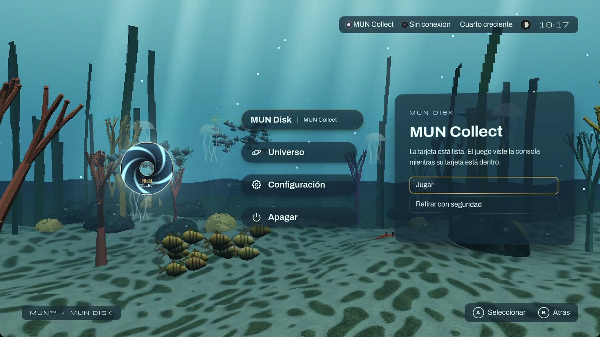
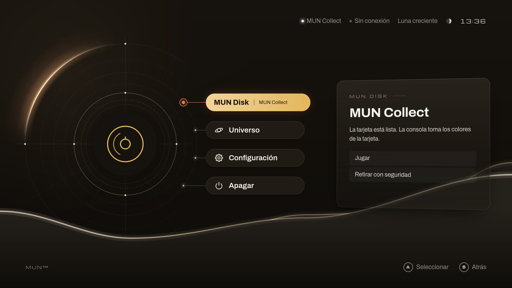
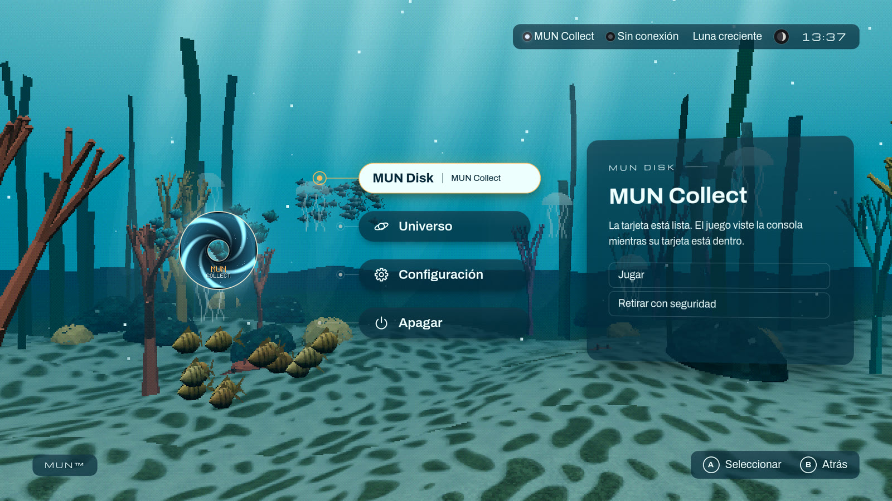

# MUN OS

[English](README.md) · **Español**

MUN OS es el sistema operativo abierto de MUN, una consola en desarrollo
para juegos físicos que son tuyos. Ya puedes probarlo en tu ordenador con
QEMU.

> **La v0.1.0-dev.5 es una versión preliminar de desarrollo:** una imagen
> ARM64 experimental para una consola virtual, no la consola en sí.
> [Lo que funciona y lo que todavía no](#lo-que-funciona-hoy-y-lo-que-todavía-no).

▶ [Mira 27 segundos de la v0.1.0-dev.5](https://github.com/user-attachments/assets/cd53cfca-da51-44ce-bae6-20aa61908423): entra un MUN Disk vestido
con Reef, el arrecife responde a Jugar y el disco se retira con seguridad.
Grabado en tiempo real de la imagen publicada, con el sonido de la propia
consola ([cómo](docs/images/README.md#the-recording), en inglés).

**MUN Shape v1**, el contrato estable, da al disco de un juego sus colores,
materiales y sonidos en la consola; el arrecife que se mueve es el
movimiento de Shape, un **borrador experimental** cuyos nombres y límites
pueden cambiar en cualquier versión.

- **[Probar MUN OS](docs/es/getting-started.md).** Descarga la versión
  preliminar y arranca la consola virtual, sin compilar: necesitas Python y
  QEMU ([compatibilidad](docs/es/compatibility.md)).
- **[Crear para MUN](docs/es/guides/create-game-card.md).** Pon tu juego en
  un MUN Disk, que su formato y sus herramientas llaman *Game Card*, y
  [viste la consola con él](docs/es/guides/shape-your-game.md) gracias a
  MUN Shape.
- **[Contribuir](CONTRIBUTING.es.md#cómo-ayudar).** Pruébalo en tu
  ordenador, avisa de lo que falla, traduce o elige una de las
  [tres tareas que necesitamos hoy](CONTRIBUTING.es.md#primeras-tareas).

## BOP: Buy. Own. Play. (Compra. Posee. Juega.)

Una Game Card legítima basta para poseer su juego y jugarlo. En la consola
virtual, con imágenes de disco en lugar de tarjetas:

- **Insértala y juega.** El juego arranca desde la tarjeta, sin cuenta, sin
  activación y sin red.
- **Tu progreso viaja con la tarjeta.** Las partidas se escriben en la
  tarjeta, no en la consola: otra consola, u otra build de MUN OS, continúa
  desde ella.
- **Retírala con seguridad,** y la tarjeta sale de la ranura con todo lo que
  lleva.
- **La consola no guarda una biblioteca.** Su almacenamiento es para el
  sistema; *Universo*, en la pantalla principal, lo dice claro: tus juegos
  viajan en sus propios soportes.

## Lo que funciona hoy, y lo que todavía no

MUN OS v0.1.0-dev.5 es una versión preliminar de desarrollo. En la consola
virtual:

- **MUN Shell**, la interfaz propia de la consola, arranca sola: su arranque
  con sonido y después la pantalla principal, una órbita con cuatro
  entradas: MUN Disk (la tarjeta que hay en la ranura), Universo,
  Configuración y Apagar. *MUN Disk* es el nombre que está tomando el
  soporte de la consola y la pantalla principal ya lo usa; el formato, las
  herramientas y estas páginas siguen diciendo Game Card.
  Configuración tiene inglés o español, de 720p a 1440p, sonidos, *Reducir
  movimiento*, y restablecer los ajustes o toda la consola. Si se deja diez
  minutos sin tocar, la pantalla se atenúa.
- **Teclado y mandos.** El teclado maneja todos los menús. También un
  mando: su cruceta o su palanca izquierda, su botón inferior para aceptar
  y el de su derecha para volver (la disposición de Nintendo en los mandos
  de ese estilo). Se ha probado con un mando, por Bluetooth en MUN Dev, no
  en la consola virtual. Los juegos siguen recibiendo solo el teclado y el
  puntero.
- **Las Game Cards** se validan antes de que se ejecute nada de ellas. Un
  juego arranca aislado y devuelve la consola acabe como acabe, sus partidas
  van a la tarjeta y una tarjeta se retira con seguridad. Los juegos hechos
  con SDL u OpenGL arrancan en la resolución de la consola.
- **MUN Shape v1:** un paquete declarativo de recursos en la tarjeta (una
  paleta, materiales, el objeto de la tarjeta, un mundo detrás de los menús,
  transiciones y sonidos) que la consola dibuja con su propio código mientras
  la tarjeta está dentro; nada de la tarjeta se ejecuta. MUN conserva la
  disposición, los textos, Configuración y la legibilidad, y el jugador decide
  cuánto se muestra.
- **El movimiento de MUN Shape, un borrador experimental.** Un paquete puede
  traer además una escena que se mueve detrás de los menús y les responde:
  planos a distintas profundidades, criaturas que siguen recorridos,
  partículas y luz, declarados como datos y reproducidos por el reproductor
  de la propia consola. **Reef** es su ejemplo: un mar con bancos de peces,
  un tiburón, cangrejos y algas detrás de la pantalla principal, y un banco
  que se reúne cuando el foco está en Jugar. Los nombres y los límites del
  borrador pueden cambiar en cualquier versión; v1 es el contrato estable, y
  un paquete con movimiento conserva un aspecto v1 para las consolas que
  solo leen v1 ([el movimiento de MUN Shape](docs/shape-motion.md), en
  inglés).
- **Ejemplos:** MUN Collect, un juego pequeño; una prueba de gráficos y
  audio; tres paquetes de MUN Shape (`sea`, `paper` y Reef, con el estudio
  que lo hace).

| MUN Collect, sin paquete | La misma tarjeta vestida con Reef |
| --- | --- |
|  |  |

Son capturas de la consola virtual
([de dónde sale cada imagen](docs/images/README.md), en inglés). Una imagen
deja a Reef quieto: `./mun play --card collect-reef` lo muestra en
movimiento ([primeros pasos](docs/es/getting-started.md#7-mira-mun-shape)).

**En MUN Dev,** nuestra placa de desarrollo (una Radxa Dragon Q6A), el mismo
sistema funciona en hardware real: 1080p a 60 Hz por HDMI con la GPU de la
placa, sonido, Game Cards en tarjetas microSD en su ranura y partidas
escritas en ellas. Es un perfil experimental que construyes tú, sin imagen
para descargar, y no es la consola: [MUN Dev](docs/es/mun-dev.md) dice qué
se ha comprobado allí y qué no.

**Todavía no:** actualizaciones de tarjetas y del sistema, mandos en los
juegos y en la consola virtual, emparejamiento de mandos en el sistema, el
hardware propio de la consola y su lector de tarjetas. La [arquitectura](docs/architecture.md)
(en inglés) dice qué existe y qué está previsto.

## Abierto, y hacia dónde va

La obra propia de MUN OS tiene licencia [Apache License 2.0](LICENSE): puedes
estudiar el código, cambiarlo, reconstruir la imagen y distribuirla según
los términos de sus licencias. Cada versión publica el código fuente
correspondiente de todos los paquetes de su imagen; los componentes de
terceros conservan sus propios términos, y los nombres y logotipos de MUN y
Play MUN tienen [los suyos](NAME-AND-LOGO.txt)
([licencias](docs/licensing.md), en inglés).

Hoy una versión preliminar lleva una imagen experimental, ARM64 como lo será
la consola, que QEMU ejecuta como consola virtual; la propia imagen lo dice
(`environment = "qemu-arm64"`, `release = false`). El código fuente tiene
además el perfil de MUN Dev, nuestra placa de desarrollo
([MUN Dev](docs/es/mun-dev.md)). MUN -1, la primera consola, tendrá **una
única configuración de hardware con soporte oficial**. Se diseña alrededor
de la Radxa Dragon Q8B, una placa distinta de la de MUN Dev, en la que MUN
OS todavía no se ha ejecutado; la consola montada y las versiones DIY sobre
esa configuración usarán la misma imagen oficial. Abierto y adaptable no
significa que hoy funcione en cualquier placa: un port físico necesita su
propia integración (arranque, pantalla, sonido, entrada, almacenamiento, el
lector de tarjetas), como muestra el perfil de MUN Dev, y los ports a otro
hardware son bienvenidos como forks mantenidos por separado. Las
[versiones](https://github.com/Play-MUN/mun-os/releases) y las
[pull requests](https://github.com/Play-MUN/mun-os/pulls) muestran hacia
dónde va.

## Dónde funciona

Todos los ordenadores de abajo ejecutan la misma imagen con las mismas
herramientas; solo cambia cómo se instala QEMU
([primeros pasos](docs/es/getting-started.md#1-qué-necesitas)). QEMU ejecuta
la consola con la virtualización del propio procesador en un ordenador ARM64
cuyo sistema se la ofrece a QEMU (macOS en Apple Silicon, Linux con KVM); si
no, tanto en x86_64 como en ARM64, emula el procesador: la misma consola, más
lenta.

| Tu ordenador | El procesador de la consola | Comprobado |
| --- | --- | --- |
| macOS, Apple Silicon | Virtualizado (HVF) | La v0.1.0-dev.5 en un Mac (macOS 27): su descarga instalada, arrancar, MUN Collect y la tarjeta vestida con Reef, jugar y apagar, sin pantalla, y el sonido del arranque grabado; con ventana, teclado y sonido, una construcción anterior de esta versión preliminar. La v0.1.0-dev.5, además, en CI en macOS 15, sin pantalla y emulado (no hay HVF dentro de una VM) |
| Linux, x86_64 o ARM64 | Emulado; KVM en ARM64 aún sin probar | La v0.1.0-dev.5 en CI, sin pantalla; la v0.1.0-dev.2, además, en máquinas virtuales Ubuntu 24.04 |
| Windows, x86_64 o ARM64 | Emulado | La v0.1.0-dev.5 en CI (Windows Server 2025; Windows 11 ARM64), sin pantalla |

«En CI» es el flujo de trabajo Hosts: descargar una versión preliminar,
arrancar la consola, jugar su tarjeta y apagar, en las máquinas virtuales de
GitHub, sin ventana. Comprueba los archivos de cada versión preliminar antes
de publicarlos, y las notas de esa versión dan el resultado: la v0.1.0-dev.5
pasó en los cinco ([su ejecución](https://github.com/Play-MUN/mun-os/actions/runs/43887723257)). Todavía no se ha
probado en ningún ordenador con Linux o Windows, ni con ventana, teclado y
sonido fuera de macOS.

Fuera de QEMU, MUN OS funciona en MUN Dev, nuestra placa de desarrollo, con
un perfil propio: [qué se ha comprobado allí](docs/es/mun-dev.md#qué-se-ha-comprobado).

## Principios

- Una Game Card legítima puede arrancar su juego, si funciona sin conexión,
  sin cuenta ni servidor de activación. Las funciones en línea opcionales
  tienen que ser explícitas.
- Las partidas viven en la tarjeta y viajan entre consolas.
- El almacenamiento interno de la consola es para el sistema, la
  recuperación, cachés acotadas y espacio temporal, no para instalar la
  biblioteca del jugador.
- Las actualizaciones, cuando existan, mantendrán disponible la versión
  original de un juego.
- El software común depende de los contratos de MUN y de Linux; el arranque,
  la GPU, la NPU, el lector y los detalles térmicos pertenecen a la
  integración del hardware.
- Los datos de juego que aporta un jugador están separados del software de
  MUN: MUN OS no lleva ningún juego salvo sus propios ejemplos.

## Documentación

- [Primeros pasos](docs/es/getting-started.md) y
  [compatibilidad](docs/es/compatibility.md)
- [Construir la imagen tú mismo](docs/es/getting-started.md#construir-la-imagen-tú-mismo)
  a partir de entradas con versión fijada, cambiarla y ejecutar la tuya
  (comprobado en un Mac con Apple Silicon)
- [Crear una Game Card](docs/es/guides/create-game-card.md) y
  [traer un juego a MUN](docs/es/guides/port-a-game.md)
- [Vestir la consola con tu juego](docs/es/guides/shape-your-game.md) con MUN
  Shape, y [verlo en acción](docs/es/guides/see-shape-in-action.md)
- Para autores de tarjetas y juegos: [Game Cards](docs/game-cards.md),
  [partidas](docs/saves.md), [ejecutar un juego](docs/runtime.md),
  [MUN Shape](docs/shape.md) y [su movimiento](docs/shape-motion.md)
  (borrador), en inglés
- [Arquitectura](docs/architecture.md), [construcción de la imagen](os/README.md),
  [laboratorio](vm/README.md) (en inglés), [MUN Dev](docs/es/mun-dev.md) y
  [todos los documentos](docs/es/README.md)
- [Licencias](docs/licensing.md) (en inglés), [seguridad](SECURITY.es.md),
  [contribuir](CONTRIBUTING.es.md)

## Mapa del repositorio

| Ubicación | Responsabilidad |
| --- | --- |
| `services/` | MUN Shell, el servicio de tarjetas y el lanzador |
| `tools/` | `mun-card` y el paquete compartido de tarjetas |
| `os/` | La composición de la imagen de MUN OS: entradas con versión fijada, configuración de mkosi, scripts del constructor, los perfiles (el de la consola virtual y el de MUN Dev) |
| `vm/` | El laboratorio: VM constructoras, invitados de imagen, tarjetas virtuales, descargas |
| `mun` | El punto de entrada de las herramientas: `./mun get`, `./mun play`, `./mun card`, `./mun dev` |
| `examples/` | Juegos de ejemplo y paquetes de MUN Shape |
| `tests/`, `scripts/` | Las regresiones del anfitrión y la comprobación de la documentación |
| `docs/` | Guías, contratos, arquitectura y referencia; las traducciones al español, en `docs/es/` |
| `.local/` | Ignorado: builds, invitados, imágenes de tarjeta, descargas |

`make check` (Python 3.9 o posterior, Make) ejecuta la comprobación de la
documentación, la de sintaxis de Python, las regresiones del anfitrión y, con
un compilador de C, las pruebas de partidas del juego de ejemplo: sin red ni
VM.

## Quién lo hace, y la licencia

MUN lo hace **Play MUN**, el estudio de **Iván Moreno Mendoza**, que fundó el
proyecto y mantiene MUN OS: revisa los cambios y decide qué entra en su
versión oficial. La obra propia de MUN OS es Copyright 2026 Iván Moreno
Mendoza, con licencia [Apache License 2.0](LICENSE) ([NOTICE](NOTICE)); las
contribuciones siguen siendo de sus autores y se licencian en los mismos
términos. Los componentes de terceros (tipografías, paquetes de Debian)
conservan sus propios términos, y la Apache License no concede derechos sobre
los nombres y logotipos de MUN y Play MUN, que tienen
[sus propios términos](NAME-AND-LOGO.txt):
[licencias](docs/licensing.md) (en inglés). MUN™ es una marca de Iván Moreno
Mendoza.

Los textos de las licencias (`LICENSE`, `NOTICE`, `NAME-AND-LOGO.txt`) están
en inglés y son los que valen; este resumen no los sustituye.

El proyecto tuvo antes otro nombre. Las Game Cards que se hicieron entonces
llevan `neptune.toml`, guardan como `neptune-save/1` y dan a sus juegos
variables `NEPTUNE_*`; la consola todavía las lee y las juega, y
`mun-card convert` hace una copia MUN si se le pide
([generaciones de nombres](docs/game-cards.md#naming-generations), en inglés).
