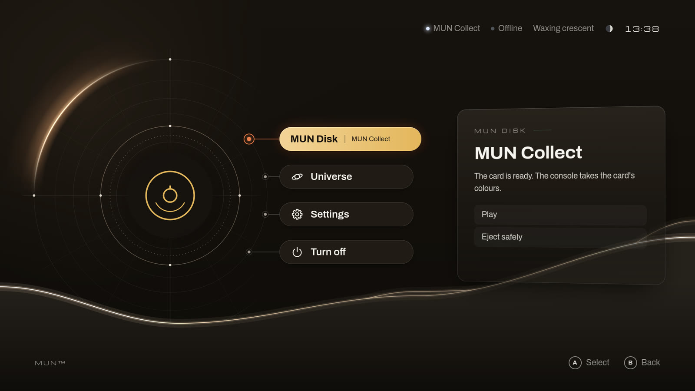
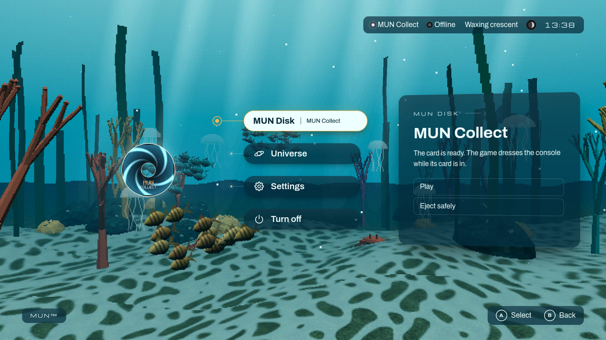

# MUN OS

**English** · [Español](README.es.md)

MUN™ is a game console we are building in the open, for games you own on
Game Cards. MUN OS is its operating system, open source and developed in
public. You can already run it on your computer as a virtual console, try
it, take it apart and take part. We also run it on a development board,
MUN Dev; the console's own hardware comes later.

## What you can do today

1. **Try MUN OS, without compiling.** Download the tools and a ready-made
   image, start the virtual console, insert a Game Card, play, save, eject
   it safely and continue later: [getting started](docs/getting-started.md).
   You need Python and QEMU.
2. **Create for MUN.** Put a game on a Game Card, and dress the console in
   its identity with MUN Shape: [create a Game Card](docs/guides/create-game-card.md),
   [bring a game to MUN](docs/guides/port-a-game.md) and
   [dress the console in your game](docs/guides/shape-your-game.md). The
   card tools also need e2fsprogs.
3. **Build and adapt the system.** Build the image yourself from pinned
   inputs, change it and run your own: [build the image yourself](docs/getting-started.md#build-the-image-yourself),
   [image build](os/README.md) and [architecture](docs/architecture.md).
   Building is checked on a Mac with Apple Silicon.
4. **Contribute and follow.** Try it on your computer, report what fails or
   confuses, translate, make sample packages and games, work on the services
   and tools: [contributing](CONTRIBUTING.md#ways-to-help). The
   [releases](https://github.com/Play-MUN/mun-os/releases) and the
   [pull requests](https://github.com/Play-MUN/mun-os/pulls) show where it
   is going.

Playing, making cards and building each have their own requirements:
[compatibility](docs/compatibility.md).

## BOP — Buy. Own. Play.

A legitimate Game Card is enough to own its game and play it. In the
virtual console, with disk images standing in for cards:

- **Insert it and play.** The game starts from the card, with no account,
  no activation and no network.
- **Your progress travels with the card.** Saves are written to the card,
  not to the console: another console, or another build of MUN OS,
  continues from it.
- **Eject it safely,** and the card leaves the slot with everything it
  carries.
- **The console keeps no library.** Its storage holds the system;
  *Universe*, on Home, says it plainly: your games travel on their own
  media.

## What works today, and what does not yet

MUN OS v0.1.0-dev.5 is a development preview. In the virtual console:

- **MUN Shell**, the console's own interface, starts on its own: its
  start-up with sound, then Home, an orbit with four entries: MUN Disk (the
  card in the slot), Universe, Settings and Turn off. *MUN Disk* is the
  name the console's medium is taking and Home already uses it; the
  format, the tools and these pages still say Game Card. Settings has
  English or
  Spanish, 720p to 1440p, sounds, *Reduce motion*, and resetting the
  settings or the whole console. Left alone for ten minutes, the screen
  dims.
- **Keyboard and controllers.** The keyboard drives every menu. So does a
  controller: its directional pad or left stick, its bottom button to
  accept and the one to its right to go back (Nintendo's layout on
  Nintendo-style pads). That has been tried with one pad, over Bluetooth on
  MUN Dev, not in the virtual console. Games still get the keyboard and the
  pointer only.
- **Game Cards** are validated before anything on them runs. A game starts
  sandboxed and hands the console back however it ends, its saves go to the
  card, and a card is ejected safely. Games built on SDL or OpenGL start in
  the console's resolution.
- **MUN Shape v1:** a declarative package of resources on the card
  (a palette, materials, the card object, a world behind the menus,
  transitions and sounds) that the console draws with its own code while the
  card is in; nothing on the card runs. MUN keeps the layout, the words,
  Settings and legibility, and the player decides how much of it to show.
- **MUN Shape's motion, an experimental draft.** A package may also bring a
  scene that moves behind the menus and answers them: planes at depths,
  creatures on paths, particles and light, declared as data and played by
  the console's own player. **Reef** is its example: a sea with schools of
  fish, a shark, crabs and kelp behind Home, and a school that gathers when
  the focus is on Play. The draft's names and limits may change in any
  version; v1 is the stable contract, and a package with motion keeps a v1
  look for consoles that only read v1 ([MUN Shape motion](docs/shape-motion.md)).
- **Examples:** MUN Collect, a small game; a graphics and audio probe;
  three MUN Shape packages (`sea`, `paper` and Reef, with the studio that
  makes it).

| MUN Collect, without a package | The same card dressed in Reef |
| --- | --- |
|  |  |

These are screenshots of the virtual console
([where each image comes from](docs/images/README.md)). A picture holds
Reef still: `./mun play --card collect-reef` shows it moving
([getting started](docs/getting-started.md#7-see-mun-shape)).

**On MUN Dev,** our development board (a Radxa Dragon Q6A), the same system
runs on real hardware: 1080p at 60 Hz over HDMI through the board's GPU,
sound, Game Cards on microSD cards in its slot, saves written to them. It
is an experimental profile you build yourself, with no image to download,
and it is not the console: [MUN Dev](docs/mun-dev.md) says what has been
checked there and what has not.

**Not yet:** card and system updates, controllers in games and in the
virtual console, controller pairing in the system, the console's own
hardware and its card reader. [Architecture](docs/architecture.md) says what exists and what
is planned.

## Open, and where it is going

MUN OS's own work is under the [Apache License 2.0](LICENSE): you may study
the code, change it, rebuild the image and distribute it under the terms of
its licences. Each release publishes the corresponding source of every
package in its image; third-party components keep their own terms, and the
MUN and Play MUN names and logos have [their own](NAME-AND-LOGO.txt)
([licensing](docs/licensing.md)).

Today a preview release carries one experimental image, ARM64 like the
console will be, that QEMU runs as a virtual console; the image says so
itself (`environment = "qemu-arm64"`, `release = false`). The source also
has the profile of MUN Dev, our development board
([MUN Dev](docs/mun-dev.md)). MUN -1, the first console, will have **one
officially supported hardware configuration**. It is being designed around
the Radxa Dragon Q8B, a different board from MUN Dev's, on which MUN OS has
not run yet; the assembled console and DIY builds on it will use the same
official image. Open and adaptable does not mean it runs on any board
today: a physical port needs its own integration (boot, display, sound,
input, storage, the card reader), as MUN Dev's profile shows, and ports to
other hardware are welcome as independently maintained forks.

## Where it runs

Every computer below runs the same image with the same tools; only how QEMU
is installed differs ([getting started](docs/getting-started.md#1-what-you-need)).
QEMU runs the console with the processor's own virtualization on an ARM64
computer whose system offers it to QEMU (macOS on Apple Silicon, Linux with
KVM); otherwise, on x86_64 and on ARM64 alike, it emulates the processor:
the same console, slower.

| Your computer | The console's processor | Checked |
| --- | --- | --- |
| macOS, Apple Silicon | Virtualized (HVF) | v0.1.0-dev.5 on a Mac (macOS 27): its bundle installed, start, MUN Collect and the card dressed in Reef, play and power-off, headless, and the start-up's sound recorded; a window, keyboard and sound with an earlier build of this preview. v0.1.0-dev.4 also in CI on macOS 15, headless and emulated (no HVF in a VM) |
| Linux, x86_64 or ARM64 | Emulated; KVM on ARM64 not tried yet | v0.1.0-dev.5 pending. v0.1.0-dev.4 in CI, headless; v0.1.0-dev.2 also in Ubuntu 24.04 virtual machines |
| Windows, x86_64 or ARM64 | Emulated | v0.1.0-dev.5 pending. v0.1.0-dev.4 in CI (Windows Server 2025; Windows 11 ARM64), headless |

"In CI" is the Hosts workflow: download a preview, start the console, play
its card, power off, in GitHub's virtual machines, without a window. It
checks each preview once it is published, and that preview's release notes
give the result: v0.1.0-dev.4 passed on all five
([its run](https://github.com/Play-MUN/mun-os/actions/runs/38839513795));
v0.1.0-dev.5's result is added when it has run. No Linux or Windows
computer has been tried yet, and no window, keyboard or sound outside
macOS.

Outside QEMU, MUN OS runs on MUN Dev, our development board, from a profile
of its own: [what has been checked there](docs/mun-dev.md#what-has-been-checked).

## Principles

- A legitimate Game Card can start its offline-capable game without an
  account or an activation server. Optional online features must be
  explicit.
- Saves live on the card and travel between consoles.
- The console's internal storage is for the system, recovery, bounded caches
  and scratch space, not for installing the player's library.
- Updates, once they exist, keep the original version of a game available.
- Common software depends on MUN and Linux contracts; boot, GPU, NPU, reader
  and thermal details belong to the hardware integration.
- Game data a player supplies is separate from MUN's software: MUN OS
  carries no game but its own examples.

## Documentation

- [Getting started](docs/getting-started.md) and [compatibility](docs/compatibility.md)
- [Create a Game Card](docs/guides/create-game-card.md) and
  [bring a game to MUN](docs/guides/port-a-game.md)
- [Dress the console in your game](docs/guides/shape-your-game.md) with MUN
  Shape, and [see it in action](docs/guides/see-shape-in-action.md)
- For card and game authors: [Game Cards](docs/game-cards.md),
  [saves](docs/saves.md), [running a game](docs/runtime.md),
  [MUN Shape](docs/shape.md) and [its motion](docs/shape-motion.md) (draft)
- [Architecture](docs/architecture.md), [image build](os/README.md),
  [laboratory](vm/README.md), [MUN Dev](docs/mun-dev.md) and
  [every document](docs/README.md)
- [Licensing](docs/licensing.md), [security](SECURITY.md),
  [contributing](CONTRIBUTING.md)

## Repository map

| Location | Responsibility |
| --- | --- |
| `services/` | MUN Shell, the card service and the launcher |
| `tools/` | `mun-card` and the shared card package |
| `os/` | MUN OS image composition: pinned inputs, mkosi configuration, builder scripts, the profiles (the virtual console's and MUN Dev's) |
| `vm/` | The laboratory: builder VMs, image guests, virtual cards, downloads |
| `mun` | The tools' entry point: `./mun get`, `./mun play`, `./mun card`, `./mun dev` |
| `examples/` | Example games and MUN Shape packages |
| `tests/`, `scripts/` | Host regressions and the documentation check |
| `docs/` | Guides, contracts, architecture and reference; Spanish translations in `docs/es/` |
| `.local/` | Ignored: builds, guests, card images, downloads |

`make check` (Python 3.9 or later, Make) runs the documentation check, the
Python syntax check, the host regressions and, with a C compiler, the example
game's save tests: no network, no VM.

## Who makes it, and the licence

MUN is made by **Play MUN**, the studio of **Iván Moreno Mendoza**, who
founded the project and maintains MUN OS: he reviews the changes and decides
what goes into its official version. MUN OS's own work is Copyright 2026
Iván Moreno Mendoza, licensed under the [Apache License 2.0](LICENSE)
([NOTICE](NOTICE)); contributions stay their authors' and are licensed under
the same terms. Third-party components (typefaces, Debian packages) keep
their own terms, and the Apache License grants no rights to the MUN and
Play MUN names and logos, which have [their own terms](NAME-AND-LOGO.txt):
[licensing](docs/licensing.md). MUN™ is a trademark of Iván Moreno Mendoza.

The project had another name before. Game Cards made then carry
`neptune.toml`, save as `neptune-save/1` and hand their games `NEPTUNE_*`
variables; the console still reads and plays them, and `mun-card convert`
makes a MUN copy on request
([naming generations](docs/game-cards.md#naming-generations)).
